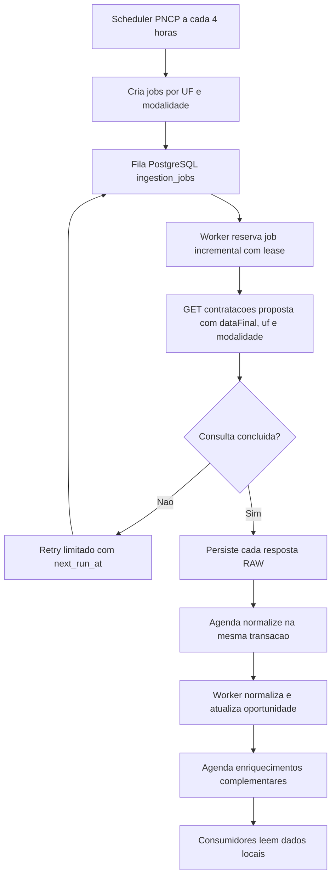
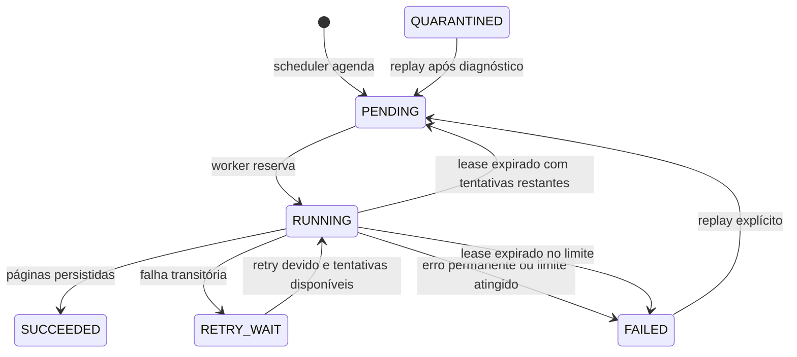

# Jobs PNCP: propostas com recebimento aberto

O pipeline PNCP mantém oportunidades públicas para os consumidores do MonitoraME. A coleta automatizada deste deployment busca somente contratações que ainda recebem propostas, pela consulta `GET /v1/contratacoes/proposta`. O scheduler limita o escopo ao Ceará (`CE`) e percorre as modalidades configuradas (por padrão, códigos 1 a 14). Não agenda consultas de publicação, atualização ou backfill histórico.

Esse endpoint é próprio para consultar contratações com recebimento de propostas aberto. Ele aceita a data final da consulta e filtros opcionais por modalidade e UF. Os filtros reduzem o conjunto consultado; a condição de recebimento aberto é determinada pela consulta oficial do PNCP.

## Fluxo principal



Cada job representa uma combinação de UF, modalidade e data final. Com a configuração padrão, são criados até 14 jobs por ciclo para o Ceará. Os jobs usam deduplicação e a fila considera somente itens PNCP. A coleta percorre todas as páginas válidas e persiste RAW antes da normalização; retries são idempotentes e não dependem de cursor histórico. O ciclo do scheduler só agenda uma nova rodada após os jobs do ciclo anterior terminarem e o intervalo configurado passar.

## Configuração

| Variável | Padrão | Uso |
|---|---:|---|
| `PNCP_SCHEDULER_FLOWS` | `propostas_abertas` | Único fluxo aceito pelo scheduler recorrente. Fluxos de publicação ou atualização interrompem a configuração para evitar coleta fora do escopo. |
| `PNCP_SCHEDULER_UFS` | `CE` | UFs consultadas; `*` significa todas as UFs do Nordeste suportadas pelo projeto. |
| `PNCP_SCHEDULER_MODALIDADES` | `1,2,...,14` | Modalidades consultadas, separadas por vírgula. |
| `PNCP_SCHEDULER_PAGE_SIZE` | `50` | Registros máximos por página, limitado pela API a 50. |
| `PNCP_SCHEDULER_CYCLE_INTERVAL_SECONDS` | `14400` | Intervalo mínimo de quatro horas entre ciclos completos. |
| `PNCP_SCHEDULER_BACKFILL_ENABLED` | `false` | Backfill histórico permanece desativado. |

O endpoint de propostas abertas retorna somente contratações abertas segundo os critérios do PNCP no momento da consulta. Uma oportunidade pode deixar de receber propostas depois de coletada; o status deve ser atualizado por nova consulta/enriquecimento conforme as políticas do pipeline.

## Etapas de persistência

1. O worker reserva o job usando transação curta, `FOR UPDATE SKIP LOCKED`, lease e token.
2. O cliente consulta todas as páginas do endpoint de propostas abertas, incluindo os filtros `uf` e `codigoModalidadeContratacao` do job.
3. Cada contratação é salva como RAW com hash e identidade externa; o job `normalize` é agendado na mesma transação.
4. A normalização atualiza a visão canônica com proteção contra regressão de versão.
5. Enriquecimento consulta detalhes, itens, documentos e histórico sem bloquear a coleta básica.

O fluxo de propostas abertas não confirma nem avança cursor de publicação/atualização. RAW permite reprocessar a normalização sem baixar novamente o edital. As rotas de leitura servem dados locais e não chamam o PNCP.

## Estados, retry e lease

| Estado | Significado |
|---|---|
| `PENDING` | Job aguardando execução. |
| `RUNNING` | Job reservado com lease ativo. |
| `RETRY_WAIT` | Falha transitória aguardando `next_run_at`. |
| `SUCCEEDED` | Todas as páginas foram processadas. |
| `FAILED` | Falha permanente ou limite de tentativas atingido; replay é explícito. |
| `QUARANTINED` | Registro mantido para diagnóstico estrutural. |

Workers usam `lease_token` para impedir que uma execução antiga conclua um job já retomado. Leases expirados elegíveis retornam à fila; os que já esgotaram tentativas terminam em `FAILED`. Timeout, HTTP 429 e erros 5xx recebem retry limitado com backoff; `Retry-After` é respeitado. Um circuito de proteção aberto adia os jobs sem consultar a API.



Eventos ficam em `ingestion_job_events`, com tipo, tentativa e contexto sanitizado. Logs incluem identificador do job, UF, modalidade, página, duração e contagens RAW/normalização, sem registrar payload completo, credenciais ou dados pessoais desnecessários.

## Operação

O Compose executa scheduler, worker de coleta, normalização e enriquecimento em processos separados, conectados ao mesmo PostgreSQL. Os serviços e arquivos Compose devem corresponder à instalação implantada.

Para conferir o backlog e os erros:

```bash
python scripts/pncp_operacao.py status
```

Para coleta manual e limitada de propostas abertas no Ceará, com todas as modalidades por padrão:

```bash
python scripts/pncp_operacao.py coletar-propostas-abertas --uf CE
```

É possível restringir modalidades repetindo `--modalidade`, por exemplo `--modalidade 6 --modalidade 8`. O comando manual agenda e executa jobs da fila; não cria backfill.

`FAILED` e `QUARANTINED` exigem replay explícito depois que o diagnóstico for entendido. Antes de operar a fila, confirme que os jobs escolhidos são do escopo desejado. Para este deployment, jobs antigos de `publicacao`, `atualizacao` e `backfill` devem ser encerrados antes de iniciar os workers novos, pois a fila é persistente entre versões do código.

## Referências oficiais da consulta

- Swagger da API PNCP Consultas: <https://pncp.gov.br/api/consulta/swagger-ui/index.html>
- Manual da API PNCP Consultas: <https://www.gov.br/pncp/pt-br/pncp/manuais/ManualPNCPAPIConsultasVerso1.0.pdf/@@download/file>
