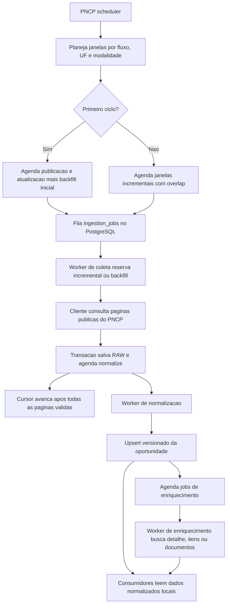
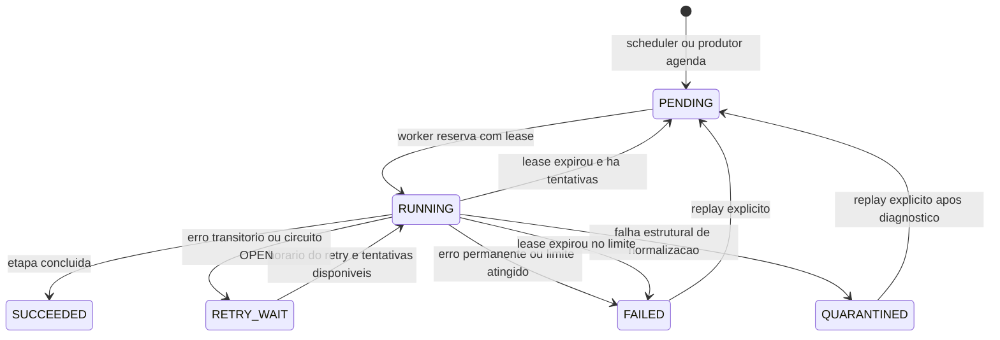

# Jobs de ingestão do PNCP

Este guia explica como os jobs do PNCP descobrem contratações, preservam as respostas originais, atualizam a visão normalizada e executam enriquecimentos. A fila persistente é a tabela PostgreSQL `ingestion_jobs`, compartilhada com outros módulos e filtrada pelos workers por `source = "PNCP"` e tipo de job.

O pipeline consome dados públicos do PNCP. Ele não publica nem altera editais e as rotas de leitura servem dados locais, sem consultar a fonte externa a cada requisição.

## Visão do fluxo

O scheduler agenda janelas independentes de `publicacao` e `atualizacao`, por fluxo, UF e modalidade. A configuração padrão deste projeto agora restringe o escopo ao Ceará (`CE`), às modalidades PNCP de código 1 a 14 e inicia o backfill no ano de 2026, com janelas históricas de sete dias. Esses valores podem ser substituídos por `PNCP_SCHEDULER_UFS`, `PNCP_SCHEDULER_MODALIDADES`, `PNCP_SCHEDULER_BACKFILL_START_YEAR` e `PNCP_SCHEDULER_BACKFILL_WINDOW_DAYS`.

No primeiro ciclo, o scheduler cria o backfill configurado. Cada ciclo acompanha os jobs que criou e só inicia outro depois que o ciclo anterior terminar e o intervalo configurado passar. A lista de modalidades deve ser conferida no domínio atual do PNCP; a API de consulta disponibiliza `GET /v1/modalidades?statusAtivo=true` para listar as modalidades ativas.



## Tipos de job

| Tipo | Responsabilidade |
|---|---|
| `incremental` | Coletar janela de publicação ou atualização prevista pelo scheduler. |
| `backfill` | Recuperar janelas históricas com prioridade menor e capacidade reservada. |
| `normalize` | Processar um registro RAW identificado por `raw_record_id`. |
| `enrich` | Consultar sob demanda recursos complementares, como detalhe, itens ou documentos. |

Agendamentos explícitos, como propostas abertas, usam os fluxos próprios descritos no contrato e não avançam o cursor incremental. O scheduler usa chave de deduplicação para evitar ocorrências equivalentes; o índice parcial impede duplicação entre jobs ativos.

## Da coleta ao RAW

O coletor percorre e valida todas as páginas da janela. Cada item é persistido como JSON original na tabela de RAW, com hash SHA-256, identidade, data de coleta e referência ao job/página. A escrita do RAW e o agendamento do job `normalize` acontecem na mesma transação. Assim, uma falha posterior não perde a resposta original e retries podem reutilizar o RAW já gravado.

O cursor só avança depois que todas as páginas válidas da janela estiverem persistidas. Se a coleta falhar antes da confirmação, a janela é repetida desde o início; a deduplicação de RAW torna a repetição idempotente. A resposta vazia que representa fim válido de paginação é aceita.

## Normalização e enriquecimento

O worker de normalização lê o RAW e atualiza a oportunidade canônica. Hashes e precedência de versão impedem que uma resposta antiga substitua uma versão mais recente. Alterações persistidas geram eventos idempotentes. Conteúdo estruturalmente inválido permanece disponível em RAW e recebe diagnóstico de quarentena.

Após a normalização, o pipeline agenda enriquecimentos ligados à versão da oportunidade. O worker busca recursos complementares e só os salva se a versão ainda for atual; assim, uma resposta atrasada não sobrescreve enriquecimento de uma versão mais nova. A coleta básica e a normalização continuam independentes do sucesso do enriquecimento.

## Estados, retries e leases

| Estado | Significado |
|---|---|
| `PENDING` | Aguardando a primeira execução ou retomada. |
| `RUNNING` | Reservado por worker com lease e token ativo. |
| `RETRY_WAIT` | Falha transitória; aguarda `next_run_at`. |
| `SUCCEEDED` | Trabalho concluído. |
| `FAILED` | Falha permanente ou limite de tentativas atingido; replay é explícito. |
| `QUARANTINED` | Registro mantido para diagnóstico estrutural; pode ser reprocessado após correção validada. |

Workers reservam jobs com `FOR UPDATE SKIP LOCKED` em transação curta e fazem chamadas HTTP fora da transação. Heartbeat renova o lease; conclusão, falha e quarentena validam o `lease_token` atual. Jobs esgotados não são reivindicados. Leases expirados retornam à fila respeitando o limite, e os que já o atingiram terminam em `FAILED`.

Timeout, HTTP 408, 429 e 5xx são tratados como transitórios com backoff e jitter. `Retry-After` é respeitado para 429. Erros de autorização e requisição inválida não recebem retry cego. O circuito de proteção compartilhado reduz a pressão sobre a fonte; quando está `OPEN`, os jobs são adiados sem chamar o PNCP.



## Recuperação, replay e observabilidade

Os workers PNCP recuperam periodicamente leases expirados e registram eventos de início, sucesso, falha, quarentena, lease e replay em `ingestion_job_events`. Contexto do job inclui escopo e diagnóstico sanitizado; payloads RAW, credenciais e cabeçalhos privados não devem ir para logs.

`FAILED` e `QUARANTINED` exigem replay explícito, selecionado pelo menor escopo possível. O replay mantém o erro anterior para auditoria, registra evento e não cria uma segunda cópia de um job equivalente que já esteja ativo. É possível selecionar um job pelo ID, um fluxo ou uma janela; seletores de janela exigem início e fim com fuso horário.

## Executar, acompanhar e reprocessar

O Compose mantém scheduler, coleta, normalização e enriquecimento em serviços separados, todos conectados ao mesmo PostgreSQL. Para iniciar ou conferir os processos:

```bash
docker compose -f compose.production.yaml up -d pncp-scheduler pncp-worker-coleta pncp-worker-normalizacao pncp-worker-enriquecimento
docker compose -f compose.production.yaml ps pncp-scheduler pncp-worker-coleta pncp-worker-normalizacao pncp-worker-enriquecimento
docker compose -f compose.production.yaml logs -f pncp-scheduler pncp-worker-coleta pncp-worker-normalizacao pncp-worker-enriquecimento
```

Para consultar o estado agregado das filas e fluxos no banco local:

```bash
docker compose -f compose.production.yaml run --rm api python scripts/pncp_operacao.py status
```

Para repetir um job específico em estado terminal:

```bash
docker compose -f compose.production.yaml run --rm api python scripts/replay_pncp_jobs.py --job-id 123
```

O replay também pode selecionar um fluxo com `--flow publicacao` ou `--flow atualizacao`. Para limitar à janela, use `--janela --inicio 2026-01-01T00:00:00+00:00 --fim 2026-01-02T00:00:00+00:00`. O seletor de janela exige ambos os limites ISO-8601 com fuso horário. Antes de reprocessar, confirme que o problema foi resolvido; para falhas de normalização, o RAW permanece guardado e disponível para diagnóstico.

Não avance cursores manualmente. Uma janela incompleta será repetida pelo job e poderá reutilizar RAW já persistido. `GET /health/pncp` é uma consulta local ao PostgreSQL e informa backlog, falhas, quarentenas e leases expirados sem chamar a API do PNCP.
