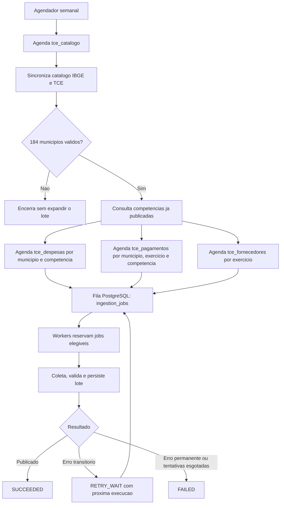
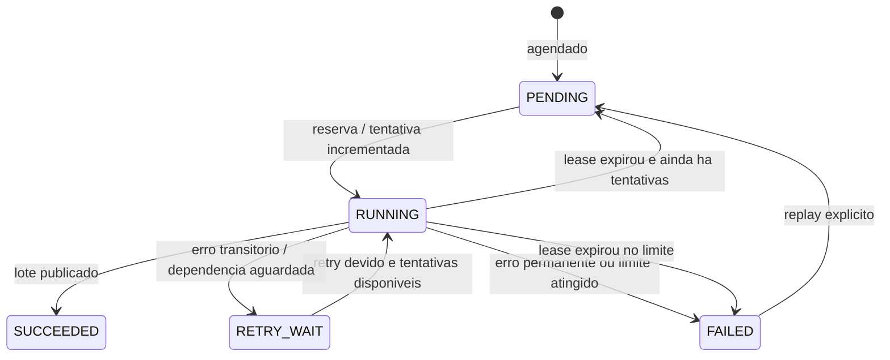
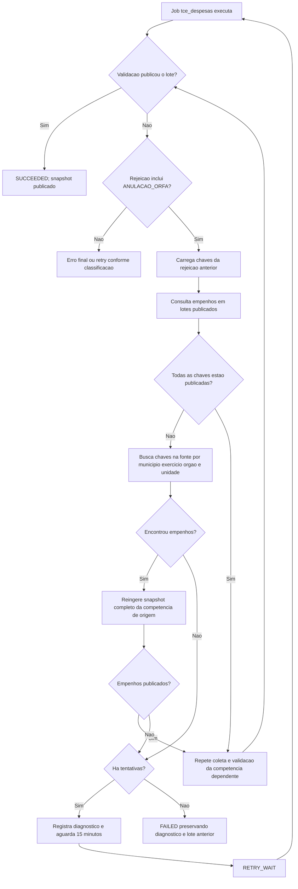

# Jobs de ingestão do TCE-CE

Este guia mostra como o pipeline agenda, executa e recupera os jobs do TCE-CE. A fila fica em `ingestion_jobs`, no PostgreSQL principal, e é processada pelos serviços `tce-scheduler` e `tce-worker`.

## Visão geral

O scheduler semanal começa por um job `tce_catalogo`. Esse job sincroniza os municípios do IBGE e do TCE e só expande o lote quando a cobertura do Ceará está válida, com os 184 municípios esperados. A expansão cria jobs de despesas e pagamentos por município e competência, além de jobs de fornecedores por exercício.

Competências ainda sem lote publicado são agendadas. As competências recentes também entram no período de overlap para capturar atualizações. O agendamento é idempotente por lote e chave de deduplicação.



## Tipos de job

| Tipo | Unidade de trabalho | O que executa |
|---|---|---|
| `tce_catalogo` | Lote semanal | Sincroniza e valida o catálogo municipal; cria os jobs do lote após validação. |
| `tce_despesas` | Município e competência (`YYYY-MM`) | Coleta despesas, empenhos e anulações e tenta publicar o snapshot da competência. |
| `tce_pagamentos` | Município, exercício orçamentário e competência | Coleta e publica o snapshot mensal de pagamentos. |
| `tce_fornecedores` | Exercício e lote semanal | Enriquece os fornecedores encontrados em dados publicados, após a conclusão dos jobs de ingestão do lote. |

Os jobs de despesas e pagamentos podem executar em paralelo. O enriquecimento de fornecedores verifica se ainda há jobs ativos de despesas ou pagamentos naquele lote; se houver, ele é adiado. Essa barreira coordena o enriquecimento, mas não ordena as competências de despesas entre si.

## Reserva, tentativas e leases

O worker reserva um job elegível em uma transação curta usando `FOR UPDATE SKIP LOCKED`. A consulta externa e o processamento ocorrem depois da reserva. O job passa a `RUNNING`, recebe `lease_token` e prazo de lease, e o worker renova o lease enquanto executa.

Jobs só são reivindicados enquanto `attempts < max_attempts`. Falhas transitórias entram em `RETRY_WAIT` com backoff. Se o lease expirar, o recuperador registra o evento de lease: jobs ainda elegíveis voltam para `PENDING`; jobs que já atingiram o limite terminam em `FAILED`. Falhas finais preservam o erro e o contexto para diagnóstico.



O lease e o token impedem que um worker atrasado conclua um job depois de outro processo tê-lo recuperado. Eventos como `STARTED`, `SUCCEEDED`, `RETRY_WAIT`, `FAILED`, `LEASE_EXPIRED`, `LEASE_EXPIRED_FAILED` e `REPLAYED` mantêm o histórico das transições.

## Dependência temporária de empenhos

Uma competência pode conter uma anulação cujo empenho correspondente ainda não foi publicado em outra competência. A validação retorna `ANULACAO_ORFA`. Como as competências podem ser processadas em paralelo, o worker trata esse diagnóstico como dependência potencialmente temporária:

1. Mantém o diagnóstico e as chaves dos empenhos ausentes da rejeição.
2. Aguarda 15 minutos antes da nova tentativa.
3. Verifica no banco se cada empenho referenciado já consta em lote publicado.
4. Para as chaves ainda ausentes, consulta o endpoint de notas de empenho do TCE filtrando município, exercício, órgão e unidade. Se encontrar uma chave, reingere a competência documental completa de origem, sem publicar um lote parcial.
5. Se o empenho for publicado, repete a ingestão da competência dependente. Se a fonte não retornar a chave ou o lote de origem não puder ser publicado, registra o retry por dependência e aguarda, respeitando `max_attempts`.
6. Se o limite se esgotar com chaves ausentes, encerra em `FAILED`, preservando a rejeição original e as chaves faltantes.



Uma falha de coleta ou validação não substitui o lote publicado anteriormente. Indicadores continuam considerando apenas lotes `PUBLICADO`.

## Replay explícito

Em geral, jobs `FAILED` não são reabertos automaticamente. A recuperação automática limitada de jobs legados por `ANULACAO_ORFA` está descrita abaixo. Para os demais casos, consulte a fila para identificar o ID e o diagnóstico:

```bash
docker compose -f compose.production.yaml run --rm api python scripts/tce_jobs.py status
```

Depois, reative somente o job escolhido:

```bash
docker compose -f compose.production.yaml run --rm api python scripts/tce_jobs.py replay --job-id 123
```

O replay é registrado como evento e reinicia o contador operacional de tentativas. Evite replay enquanto a dependência de empenho estiver ausente, pois a nova execução pode encontrar o mesmo diagnóstico.

Na inicialização, o primeiro slot do worker busca jobs `tce_despesas` em `FAILED` cuja categoria estruturada ou `last_error` indique `FalhaPermanenteJobTce`. Cada job pode receber um replay automático, registrado no histórico com a origem `startup_permanent_failure_recovery`. A seleção ignora jobs substituídos por execuções mais recentes e escopos que já tenham job ativo, e reinicia a ingestão completa do município e competência. O replay mantém a proteção do pipeline: um lote rejeitado não substitui o lote anteriormente publicado. Falhas permanentes que persistirem após esse replay permanecem disponíveis para diagnóstico e replay manual.

A recuperação legada mais específica para rejeições por `ANULACAO_ORFA` continua ativa e registrada separadamente. Para falhas permanentes novas, a busca cobre também registros cujo `last_error` tenha sido truncado, desde que `last_error_context.categoria` esteja preenchido.

Para revisar falhas permanentes em lote, use `replay-failed` primeiro sem `--confirm`. A prévia lista até 100 jobs TCE `FAILED`, com os diagnósticos e tentativas. Limite por tipo ou prefixo de escopo; por exemplo, para despesas de Acaraú:

```bash
docker compose --env-file .env -f compose.production.yaml exec -T tce-worker python scripts/tce_jobs.py replay-failed --job-type tce_despesas --scope-prefix 'despesas|026|'
```

Depois de revisar a lista, acrescente `--confirm` para reativar os candidatos. Jobs com outro job ativo usando a mesma `dedupe_key` podem ser ignorados. O replay é explícito e reinicia `attempts`; falhas que continuarem ocorrerão dentro do limite configurado e manterão seu diagnóstico.

## Executar e acompanhar os serviços

O Compose mantém scheduler e worker em processos separados, compartilhando o banco principal. Para iniciar ou conferir os serviços:

```bash
docker compose -f compose.production.yaml up -d tce-scheduler tce-worker
docker compose -f compose.production.yaml ps tce-scheduler tce-worker
docker compose -f compose.production.yaml logs -f tce-scheduler tce-worker
```

O scheduler avalia a agenda semanal de domingo às 02:00 no fuso `America/Fortaleza` e também recupera a última execução devida após reiniciar. O worker verifica leases expirados periodicamente, reserva jobs com concorrência configurada e processa a fila continuamente. A API e os indicadores leem os snapshots publicados; uma consulta de leitura não inicia uma coleta.
